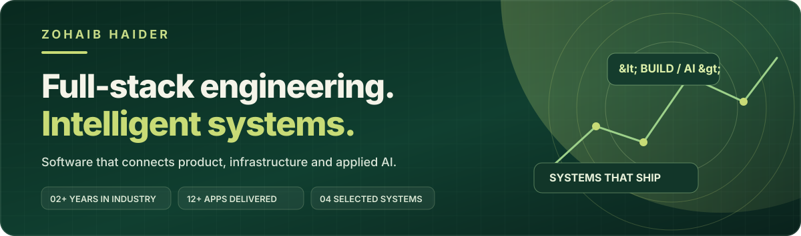
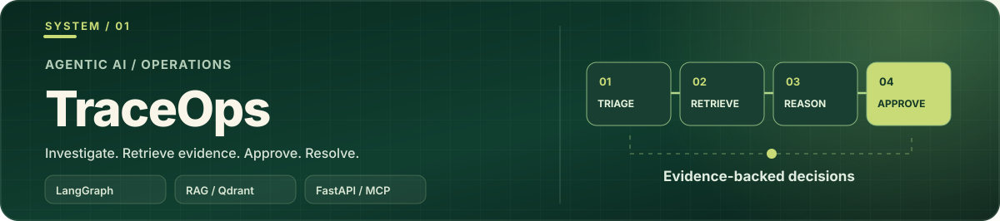
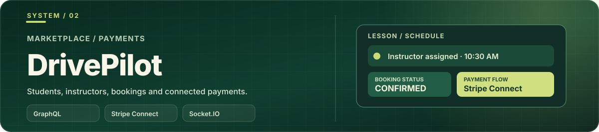
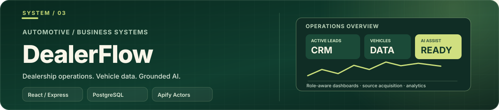
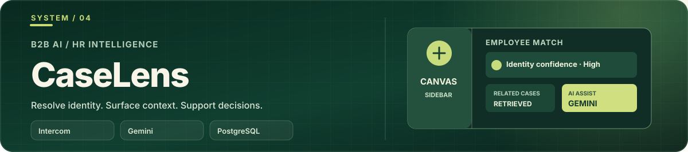
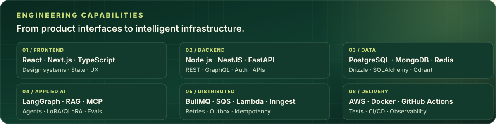

 

**FULL-STACK SOFTWARE ENGINEER** &nbsp; • &nbsp; **AI SYSTEMS BUILDER** &nbsp; • &nbsp; **PRODUCT-FOCUSED ENGINEERING**

 

 

## The engineer behind the systems

I'm **Zohaib Haider**, a **Full-Stack & AI Software Engineer** with **2+ years of experience** contributing to **12+ production applications** across SaaS, marketplaces, CRM, financial workflows, and AI-powered products.

I build the **complete product**: thoughtful React/Next.js interfaces, secure Node.js/Python APIs, reliable data models, authentication, integrations, distributed jobs, cloud infrastructure, and automated testing. My applied AI work includes **RAG, LangGraph agents, MCP, human-in-the-loop approvals, LLM evaluation, speech-to-text, and LoRA/QLoRA fine-tuning workflows**.

> **My approach:** Make it useful. Make it secure. Make it reliable. Make it understandable.

---

## 01 / Featured work

**Four products. Different engineering challenges. One end-to-end mindset.**

These are selected systems where I worked across product functionality, API design, integration complexity, data reliability, and delivery—not generic CRUD demos.

### 01 — TraceOps · AI Incident Investigation

**A multi-tenant AI incident investigation and automation platform that prioritizes evidence before action.**

- **Agentic AI:** LangGraph investigation and review workflows, tenant-scoped RAG, cited knowledge, operational tools, and resumable **human approval gates**.
- **Operational reliability:** Inngest background investigations, retries, incident memory, workflow state, and n8n integration.
- **Model engineering:** MCP/OAuth connections, voice/STT interfaces, structured LLM evaluations, and an **optional Qwen LoRA/QLoRA classification training pipeline**.

**Core stack:** `Python` `FastAPI` `React` `TypeScript` `LangChain` `LangGraph` `Qdrant` `PostgreSQL` `Redis` `Inngest` `n8n` `MCP` `Hugging Face`

**[Explore source code](https://github.com/Zebishah/TraceOps)** &nbsp;·&nbsp; **[Open live demo](https://trace-ops-pearl.vercel.app/)** &nbsp;·&nbsp; [Read architecture](https://github.com/Zebishah/TraceOps/blob/main/docs/architecture.md)

 

### 02 — DrivePilot · Marketplace & Payments

**A driving-instructor marketplace with connected experiences for students, instructors, and administrators.**

- **Full-stack product:** Instructor discovery, location and availability search, lesson bookings, progress tracking, reviews, management dashboards, and real-time messaging.
- **Financial workflows:** **Stripe Connect** payments, delayed/off-session charging, refunds, commissions, payouts, and payment state synchronization.
- **Consistency & recovery:** Slot booking guards, idempotent webhook processing, durable jobs, retries, and reconciliation for failed or incomplete payment operations.

**Core stack:** `React` `TypeScript` `Node.js` `Express` `Apollo GraphQL` `MongoDB` `Redis` `Socket.IO` `Stripe Connect` `AWS S3`

**[Explore source code](https://github.com/Zebishah/DrivePilot)** &nbsp;·&nbsp; **[Open live demo](https://drive-pilot-topaz.vercel.app/)**

 

### 03 — DealerFlow · Dealership CRM & Vehicle Intelligence

**A role-aware dealership operations platform connecting business workflows with vehicle intelligence.**

- **Multi-role dashboards:** Leads, appointments, sales, finance, commissions, performance analytics, staff records, and granular permission management.
- **Data acquisition:** Approved vehicle sources, standardized records, source health visibility, and **on-demand Apify Actors** in the current deployment.
- **AI & architecture:** Grounded assistant, PostgreSQL/Drizzle data layer, Redis caching and limits; **AWS SQS/Lambda and BullMQ** remain implemented/documented alternative pipeline paths.

**Core stack:** `React` `TypeScript` `Node.js` `Express` `PostgreSQL` `Drizzle` `Redis` `Apify` `Playwright` `Gemini / Groq` `AWS S3`

**[Explore source code](https://github.com/Zebishah/DealerFlow)** &nbsp;·&nbsp; **[Open live demo](https://dealer-flow-kappa.vercel.app/)** &nbsp;·&nbsp; [Current architecture](https://github.com/Zebishah/DealerFlow/blob/main/rta-marketing/docs/architecture/current-production.md)

 

### 04 — CaseLens · Intercom HR Case Intelligence

**An AI-assisted case intelligence platform that brings employee context directly into Intercom.**

- **Embedded AI workflow:** Intercom Canvas Kit sidebar, Gemini-supported HR case classification, contextual insights, conversation tagging, and notes.
- **Identity & relevance:** Employee matching with aliases and **PostgreSQL trigram similarity**, related-case retrieval, reviewer context, and stakeholder-routing suggestions.
- **Reliable integrations:** Signed webhooks, transactional outbox, revision-aware processing, **on-demand Apify** execution; BullMQ/Redis remains an optional processing mode.

**Core stack:** `Next.js` `React` `TypeScript` `Node.js` `Express` `PostgreSQL` `Drizzle` `Gemini` `Intercom Canvas` `Box` `Apify` `Redis / BullMQ`

**[Explore source code](https://github.com/Zebishah/CaseLens)** &nbsp;·&nbsp; **[Open live demo](https://case-lens-amber.vercel.app/)**

 

### Interested in the architecture behind these applications?

**[See the interactive portfolio & detailed case studies](https://zohaib-haider-portfolio.vercel.app/)**

---

## 02 / Engineering toolkit

**A practical stack across product development, distributed backends, cloud infrastructure, and applied AI.**

### Frontend & product interfaces

`JavaScript` · `TypeScript` · `React` · `Next.js` · `Vite` · `Tailwind CSS` · `shadcn/ui` · `Radix UI` · `Material UI` · `Ant Design` · `Redux Toolkit` · `Zustand` · `TanStack Query` · `React Hook Form` · `Zod` · `Framer Motion` · `Three.js` · `React Three Fiber` · `Recharts` · `ApexCharts`

### Backend, API design & security

`Node.js` · `Express` · `NestJS` · `Python` · `FastAPI` · `Pydantic` · `REST APIs` · `GraphQL` · `Apollo Server` · `Socket.IO` · `WebSockets` · `JWT` · `OAuth 2.0` · `RBAC` · `Multi-tenancy` · `Webhooks` · `Rate Limiting` · `API Validation`

### Applied AI, agents & model engineering

`LLM Integration` · `LangChain` · `LangGraph` · `Agent Workflows` · `RAG` · `Vector Search` · `Embeddings` · `BM25` · `Reranking` · `Qdrant` · `MCP` · `Tool Calling` · `Structured Outputs` · `Human-in-the-loop` · `LLM Evaluation` · `Prompt Engineering` · `LoRA` · `QLoRA` · `Qwen` · `PyTorch` · `Hugging Face` · `Voice / Speech-to-text` · `Gemini` · `Groq`

### Data, messaging & distributed systems

`PostgreSQL` · `Neon` · `MongoDB` · `Mongoose` · `MySQL` · `Redis` · `Upstash` · `Drizzle ORM` · `SQLAlchemy` · `Alembic` · `pg_trgm` · `BullMQ` · `AWS SQS` · `AWS Lambda` · `Inngest` · `n8n` · `Apify Actors` · `Job Queues` · `Idempotency` · `Transactional Outbox` · `Retries / Backoff` · `Reconciliation` · `Caching`

### Cloud, integrations & delivery

`AWS EC2` · `AWS S3` · `AWS CloudFront` · `AWS Route 53` · `AWS IAM` · `Docker` · `Docker Compose` · `Nginx` · `GitHub Actions` · `CI/CD` · `Vercel` · `Render` · `Linux` · `Stripe` · `Stripe Connect` · `PayPal` · `QuickBooks` · `Zoho Books` · `Intercom` · `Box` · `Resend`

### Testing & engineering quality

`Jest` · `Vitest` · `React Testing Library` · `Playwright` · `Cypress` · `pytest` · `Ruff` · `mypy` · `ESLint` · `TypeScript Checks` · `API Integration Tests` · `End-to-end Tests` · `Accessibility Testing` · `Observability`

---

## 03 / How I think about engineering

| Product experience | Reliable systems | Responsible AI |
| :--- | :--- | :--- |
| Accessible interfaces, useful workflows, clear interactions, and consistent design | Secure authorization, durable state, idempotency, observability, and graceful failure recovery | Grounded retrieval, scoped tools, evaluation, transparent evidence, and human control over consequential actions |

**The goal is not simply to connect technologies. It's to deliver software people can trust and teams can maintain.**

---

## 04 / GitHub activity

---

### Have something ambitious to build?

**Open to full-stack engineering, AI systems, freelance collaborations, and thoughtful product work.**

  

Built with engineering depth, product thinking, and attention to detail.

